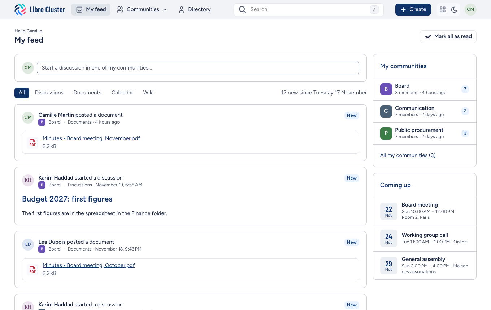

# Abilian SBE

[](https://builds.sr.ht/~sfermigier/abilian-sbe/commits/main/ubuntu-lts.yml?)

**Abilian SBE** is a free and open source collaboration platform. It gives every team, project or working group of an organisation a **community**: a shared space with its discussions, its documents, its wiki and its calendar. Members see what is new in one feed, find anything with one search, and invite the people they work with.

It has run in production since 2013, as the extranet of clusters of companies, professional networks and associations.



## What it does

- **Communities**, each with its members and managers, its tools, and its own rules: closed, open on request or open to all.
- **Discussions**, with attachments, unread messages marked, and e-mail to all members when needed.
- **Documents**, in folders, with previews, versions, comments, locks and per-folder permissions; search reads their text.
- **A wiki** in Markdown, with a live preview, links between pages and their history.
- **A calendar** per community, with each event's files and discussion, and `.ics` files for any calendar application.
- **My feed**, a daily e-mail summary, a directory of people and a search that suggests as you type.
- **An administration** for accounts, communities, settings and the log of changes.

The interface is in English and French, accessible, and works on phones.

## Documentation

The documentation is in [`docs/`](docs/), in English and French: a user guide, an administration guide, installation and configuration, and a developer guide. Build it with `make serve` in `docs/`; see [the developer guide](docs/src/develop/index.md#this-documentation).

## Trying it

You need [uv](https://docs.astral.sh/uv/), Node and npm, and Redis.

```bash
git clone https://github.com/abilian/abilian-sbe-monorepo.git
cd abilian-sbe-monorepo
make install front translations
cp example_config/dot_env .env      # then edit it
uv run flask initdb
uv run flask createuser --role admin --name Admin admin@example.org a-password
make run
```

## Running it in production

- **On [Hop3](https://hop3.cloud/)**: a small project pins the version of SBE from PyPI, and its `hop3.toml` runs it with PostgreSQL and Redis and keeps the files on a volume. See [docs/src/install/hop3.md](docs/src/install/hop3.md).
- **On a server**, Debian or Ubuntu, with PostgreSQL or MariaDB, behind nginx: see [docs/src/install/server.md](docs/src/install/server.md).

The settings are environment variables: see [docs/src/install/configuration.md](docs/src/install/configuration.md).

## Developing

```bash
make test       # the pytest suite
make test-e2e   # the browser tests, with an accessibility sweep
make lint       # the linters and checks
```

The [developer guide](docs/src/develop/index.md) describes the code, the tests and how to contribute. Design decisions are recorded as [Architecture Decision Records](notes/adrs/), and the changes in the [changelog](CHANGELOG.md).

## Licence

Abilian SBE is free software, under the [GNU Lesser General Public License, version 3](LICENSES/LGPL-3.0-only.txt), developed by [Abilian](https://abilian.com/). The project follows the [REUSE](https://reuse.software/) specification: `REUSE.toml` declares the copyright and licence of every file.
