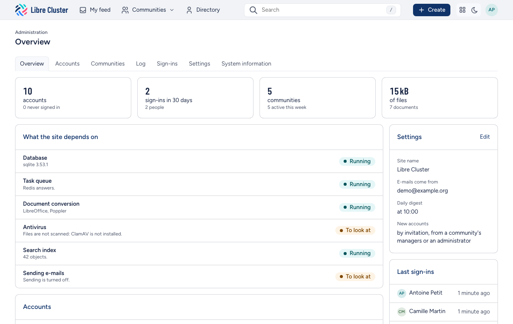

# Administration

Site administrators run the site itself: its accounts, its communities and its settings. The **Administration** entry of the account menu opens it; others do not see it. Communities run themselves: their managers invite members and choose their tools (see [Communities](../guide/communities.md)).

## Overview

The site at a glance: its accounts and how many signed in lately, its communities and how many were active this week, its documents and the space they take. Below, the state of what the site depends on (the database, the task queue, document conversion, the antivirus, the search index, e-mail), checked when the page is shown, and the settings in force.

## Accounts

Every account, with its state (active, never signed in, disabled), its communities and its last sign-in. The tabs keep one state. The field finds an account by name or address.

- **New account** creates one. People usually arrive by invitation from a community instead, and choose their own password.
- An account's page edits its names, job, organisation and address, makes it an administrator, or disables it. A disabled account can no longer sign in; what it wrote stays.
- **Send a link to choose a password** helps someone who lost theirs.
- **Sign in as** shows the site as that person sees it, to understand a problem they report.

## Communities

It lists every community, whoever is in it: its managers, its members, its documents and its last activity. **New community** creates one, with its first manager. Each community's settings and members are one click away.

## Log

What changed on the site: who created, changed or deleted what, and when. Filter it by person, by kind of object and by period, go back to a given day, and export it as a spreadsheet.

## Sign-ins

It lists the last sign-ins: who, when, for how long, and from where.

## Settings

They hold the site's name, the address e-mails are sent from, and the hour of the daily summary.

## System information

The versions of the software the site runs on, and its configuration, secrets hidden.
