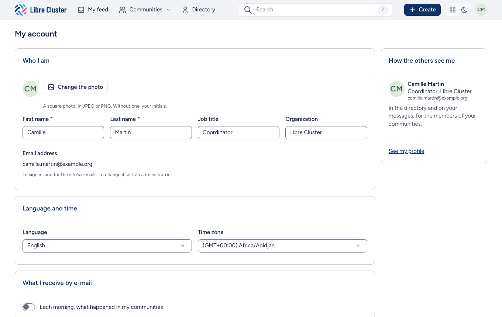

# Your account

Your initials, at the right end of the bar, open a menu: your account, your profile, the administration if you run the site, and *Log out*. **My account** gathers your settings on one page.

## Who you are

You set your photo (without one, your initials stand for you) and your first and last names. The directory also shows your job and organisation, which you set here. Your e-mail address is how you sign in: to change it, ask an administrator.

## Language and time

You choose the language of the interface and your time zone, in which dates and events are shown.

## What you receive by e-mail

**Each morning, what happened in my communities**: a daily summary of the news of your communities, sent only when there is something new.

## Password

To change your password, type the new one twice. It needs at least 8 characters, with an upper case letter, a lower case letter and a digit.
