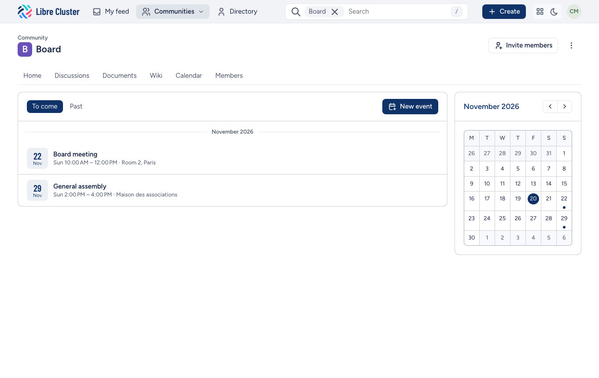

# Calendar

The calendar lists a community's events to come, by month, with the month at a glance beside them. Past events are one click away.

## Events

An event has a title, a start and an end, a place, a description and a link to read more. Its page also holds its files and, once someone has started it, its discussion.

- **Add to my calendar** downloads the event as a file that any calendar application takes in (`.ics`).
- **Copy the link** gives the event's address, to share it.
- **Discuss it** starts a discussion about the event, in the community's discussions; the event's page then leads to it.

## Posting an event

Any member can post an event, from the calendar or from the **Create** button in the bar. Whoever posted an event can change it or delete it, as can the community's managers.

Your events to come, in all your communities, also appear under *Coming up* in [My feed](index.md#my-feed).
