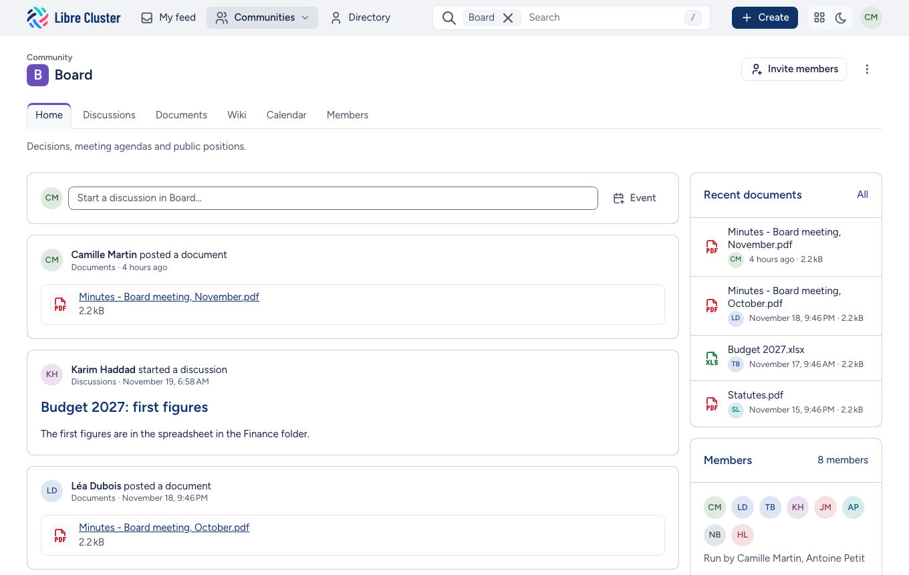
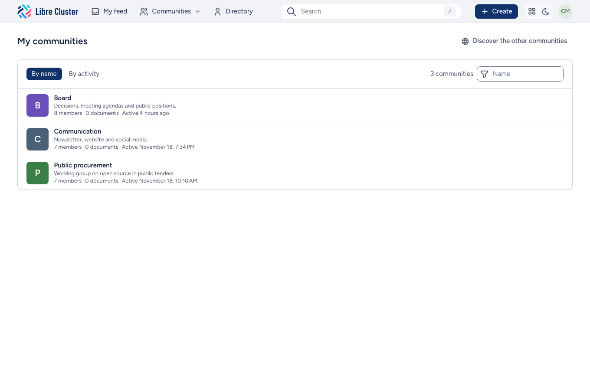
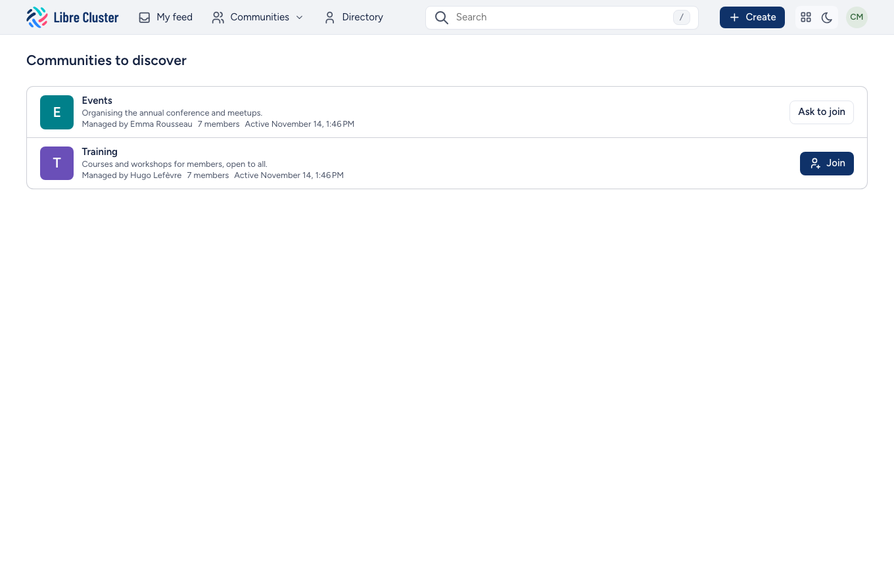
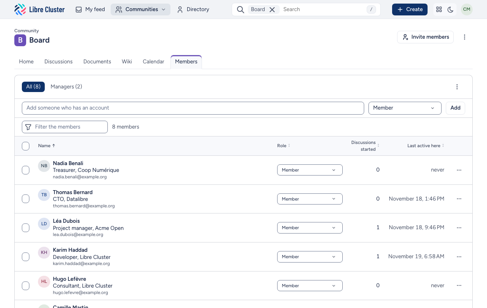

# Communities

A community gathers people around a shared purpose: a board, a project, a working group, a network of partners. Its home page shows what it is for, what is new, its recent documents and its members.

Its tools are tabs: **Home**, **Discussions**, **Documents**, **Wiki**, **Calendar** and **Members**. A community's managers choose which tools it uses.

## Your communities

The **Communities** menu in the bar lists your communities, those with something new first. *All my communities* lists them all, by name or by recent activity, with a filter.

## Joining a community

Most communities are closed: their managers invite their members. Some are open, and *Discover the other communities*, in the **Communities** menu, lists those you are not in yet.

- **Join** makes you a member at once.
- **Ask to join** sends your request to the community's managers, who accept or refuse it.

Someone who is not a member sees a community's name, what it is for and its managers, never what it holds.

## Members and roles

A community has two roles:

- **Members** take part: they read everything, start discussions, post documents and edit the wiki. In a community set to *mostly read*, only managers post documents and write to everyone by e-mail.
- **Managers** also run the community: they invite and remove members, change roles and edit its settings.

The **Members** tab lists who is in the community, their role and when they were last active. Managers change a role in place, or select several members to change or remove them at once.

## Inviting people

Managers invite from any page of the community, with **Invite members**. Type or paste e-mail addresses: as you type, each address says what will happen to it. Someone who has an account is added and told by e-mail; someone who has none gets an account and an invitation, and gives their name when they choose their password. One role applies to all. You can add a word to go with the invitation.

To invite many people at once, import a spreadsheet (CSV): one person per line, with their address, their first and last names if you know them, and their role.

## Settings

A community's managers change its settings from the **⋮** menu in its header:

- its name, what it is for and its image;
- whether its members **take part** or **mostly read**;
- its tools: discussions, documents, wiki;
- **who joins**: closed (only those invited), open on request, or open to all.

New communities are created by site administrators.
