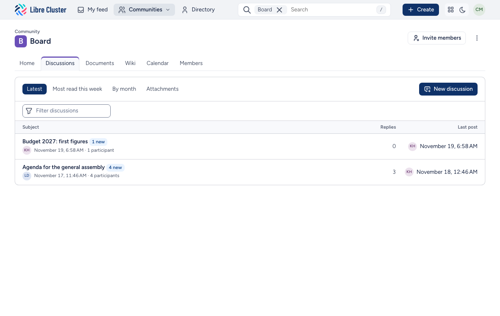
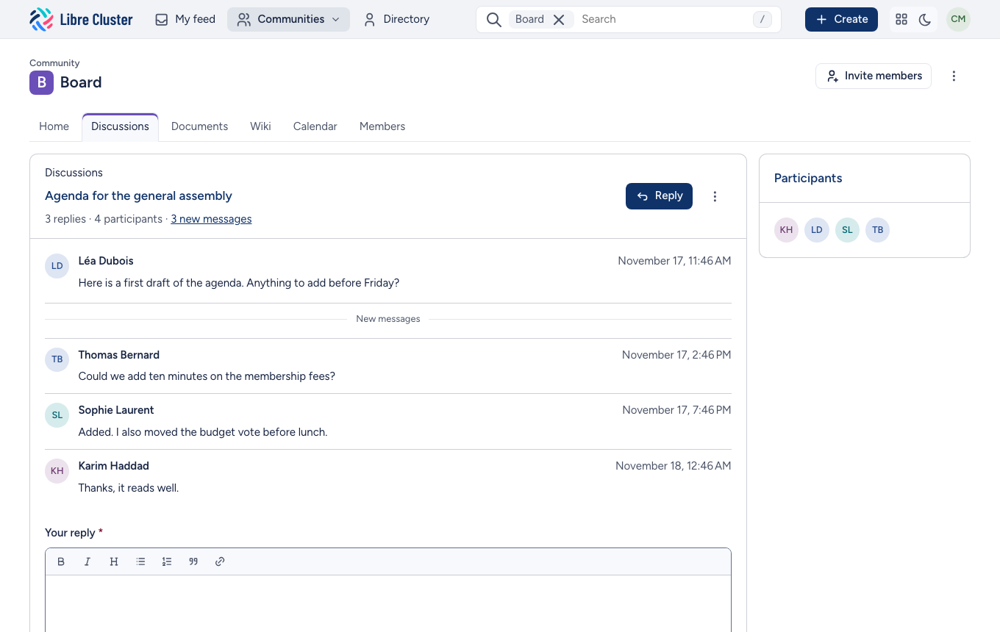

# Discussions

Discussions are where a community talks: a question, a proposal, a draft to review. Each discussion has a subject, a first message and its replies.

## Reading

The **Discussions** tab lists the community's discussions, the most recent first. Those with messages you have not read are in bold, with how many are new. The tabs show the latest, the most read this week, the discussions by month, or their attachments; the field above the list finds a discussion by words in its subject.

In a discussion, a line marks where the new messages start.

## Starting and replying

**New discussion** asks for a subject and a message, which you can format (bold, lists, quotes, links) and to which you can attach files. *Also send it to the members by email* sends it to every member of the community, in addition to the feed.

At the bottom of a discussion, **Your reply** answers it. You can edit your own messages afterwards.

## Closing

A community's managers can close a discussion that is settled: it stays readable and takes no more replies. They can also reopen it, or delete it.
