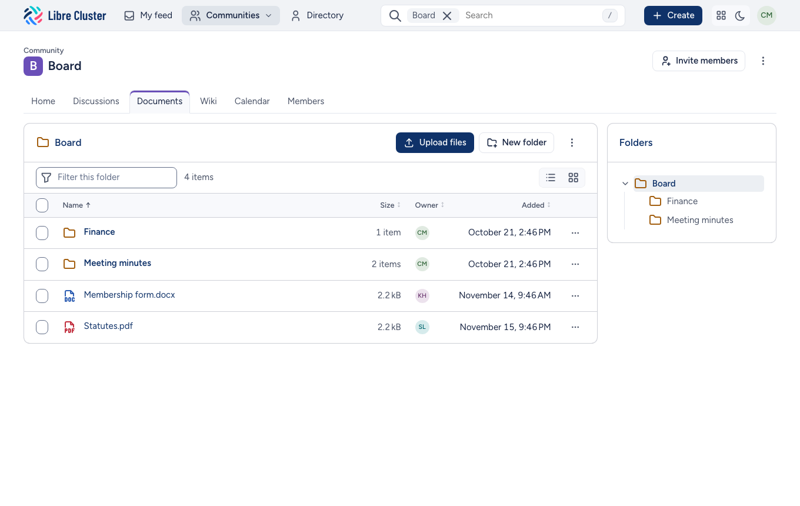
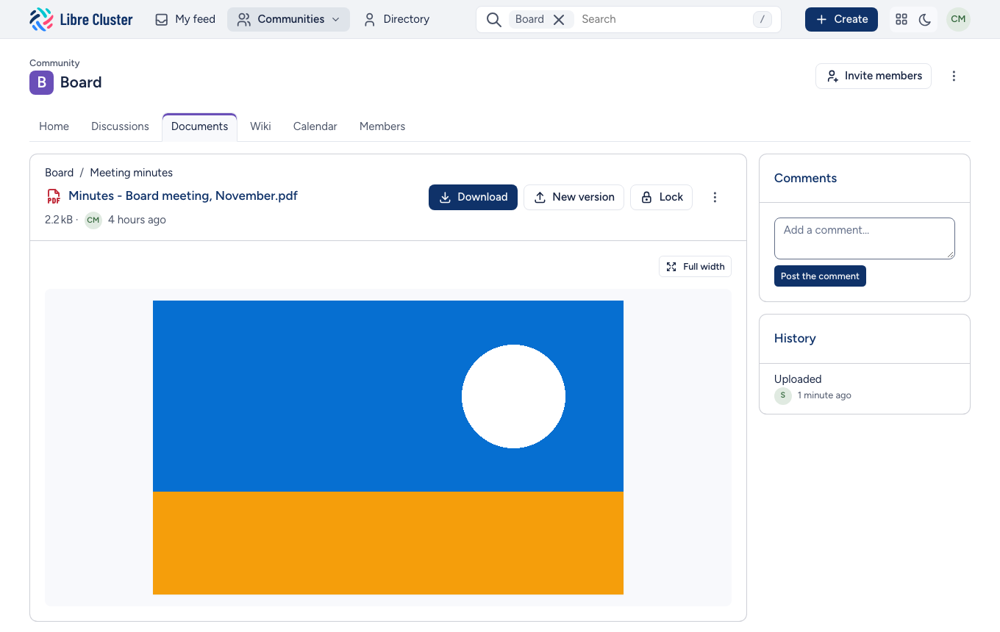

# Documents

Each community has its own documents, in folders. The **Documents** tab shows a folder: its subfolders and documents, their size, their owner and when they were added, with the tree of folders beside it.

## Adding

- **Upload files** sends one file or many, with their progress.
- **New folder** creates a folder inside the current one.

## Finding

The field above the list finds a file by its name in the folder. The list sorts by name, size, owner or date, and the buttons beside the field switch between a list and a grid of thumbnails. To search inside documents, use the [search](search.md): it reads their text.

## Working on a document

A document's page shows a preview of it, its details and its comments.

From there you can:

- **Download** it, or send it to someone **by e-mail**;
- upload a **new version**, which keeps the history of the earlier ones;
- **lock** it while you work on it, so that others know;
- **edit its properties**: its name and description;
- **comment** on it;
- **move** or **delete** it.

## Many at once

Tick the boxes in a folder to act on several items at once: download them as one archive, move them to another folder, change their owner or delete them.

## Permissions

By default, everything in a community is open to its members. The **Permissions** of a folder, in its **⋮** menu, show who has access, and let managers restrict a folder to some people.
