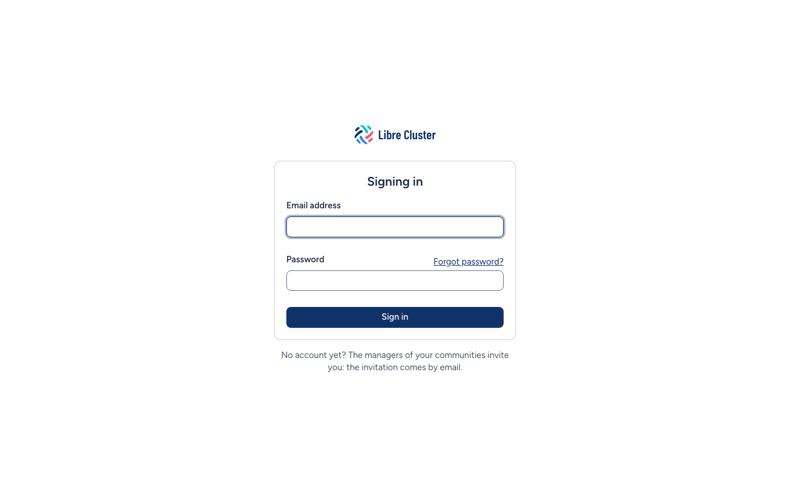
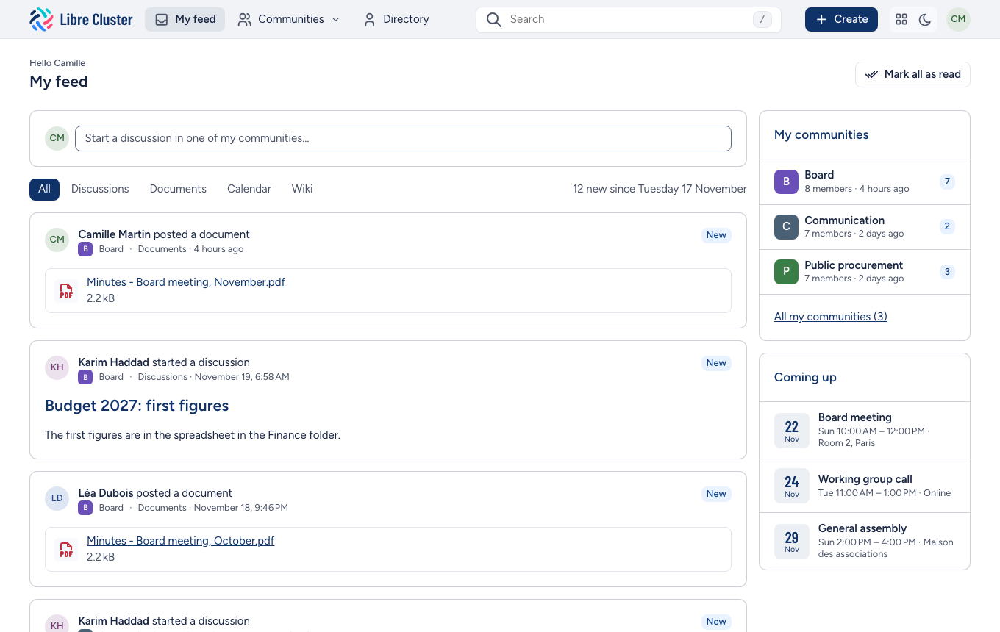

# Getting started

Abilian SBE is organised around **communities**. A community is a shared space for a team, a project or a working group, with its own discussions, documents, wiki and calendar. You see the communities you belong to; their managers invite new members.

## Signing in

You sign in with your e-mail address and your password. If you were invited, the invitation e-mail holds a link to choose your password; the link works for 24 hours, and *Forgot password?* on the sign-in page sends a new one.

## My feed

*My feed* is the home page. It lists what happened in all your communities, newest first: discussions started and answered, documents posted, wiki pages written, events announced.

- **New** marks what came since you last clicked *Mark all as read*. The communities on the right show how many new things each holds.
- The filters above the feed keep one kind of news: discussions, documents, calendar or wiki.
- The box at the top starts a discussion in one of your communities.
- *Coming up* lists the next events of your communities.

## The bar

The bar at the top of every page takes you anywhere:

- **My feed**, the home page.
- **Communities**, a menu of your communities, those with something new first, a filter for the others, and the communities you could join.
- **Directory**, the people you work with.
- **Search**, which suggests results as you type. Press `/` from any page to jump to it.
- **Create**, to start a discussion in one of your communities.
- The moon or sun button switches between the light and the dark theme, and your initials open your account.

## Next

- [Communities](communities.md): finding, joining and running them.
- [Discussions](discussions.md), [Documents](documents.md), [Wiki](wiki.md) and [Calendar](calendar.md): the tools of a community.
- [People and search](search.md): finding anyone and anything.
- [Your account](account.md): your photo, your language and what you receive by e-mail.
