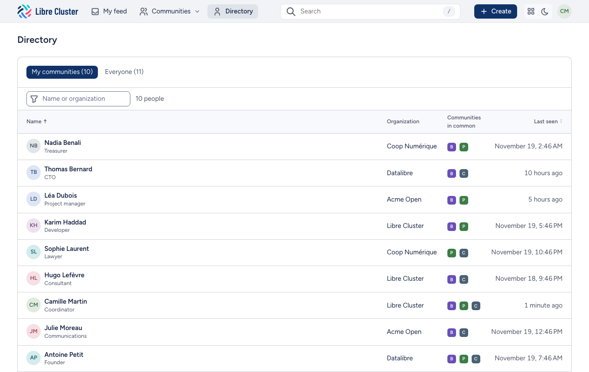
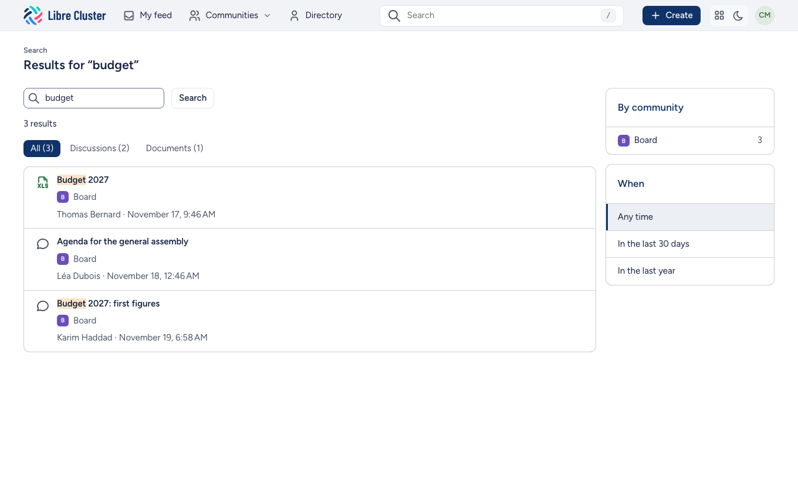

# People and search

## The directory

**Directory**, in the bar, lists the people you share a community with, and everyone on the site with the other tab. Each person shows their job, their organisation and the communities you share. The field above the list finds someone by name, job or organisation.

A person's profile shows who they are, how to reach them and their recent activity.

## Search

The search field in the bar suggests results as you type: discussions, documents, wiki pages and people, the words you typed marked. `↑` and `↓` move among them, `Enter` opens one, `Escape` closes the list, and `/` from any page jumps to the field. On an empty field, it shows your last searches and what you opened lately.

Inside a community, the search looks there first; a label in the field says so, and removing it searches everywhere.

**Enter** opens the full results, which you can narrow by kind of content, by community and by period.

The search reads the text of documents too, not only their names. It finds only what you are allowed to see.
