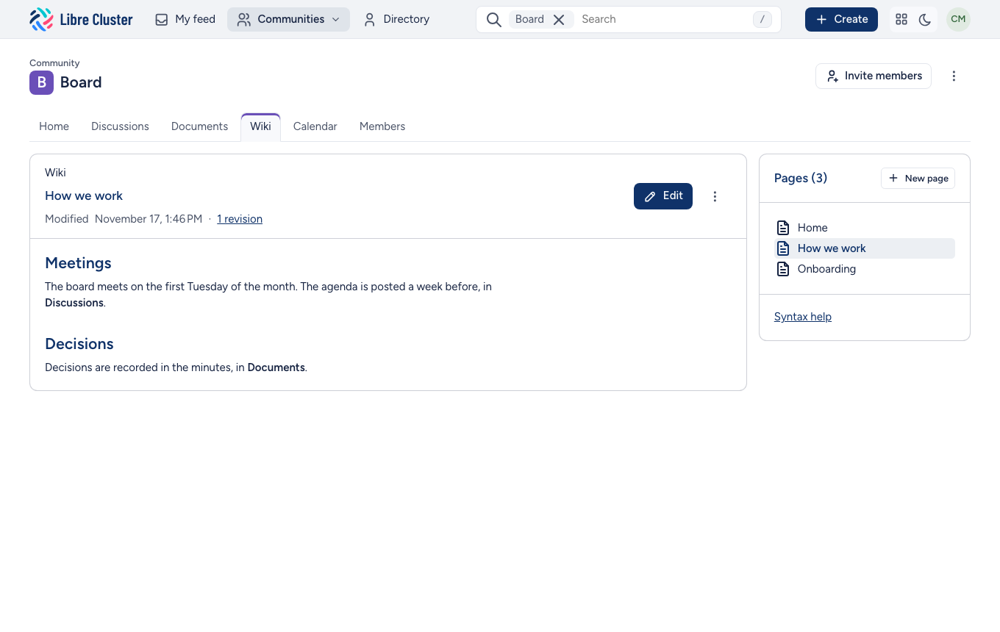

# Wiki

The wiki holds what a community wants to keep and share: how it works, its procedures, its decisions, a glossary. Pages link to each other by their titles.

## Writing

**New page** and **Edit** open the editor: the text is on the left, in Markdown, and the page as it will look is on the right, updated as you type.

- `**bold**`, `*italics*`, `## heading`, `- list`;
- `[[Title of a page]]` links to another page of the wiki. A link to a page that does not exist yet creates it when you follow it.

A short note on what you changed goes into the page's history. You can also attach files to a page, and remove them, from the same form.

## History

Every saved version is kept. The history lists them, with who wrote each and when, and compares any two of them.
