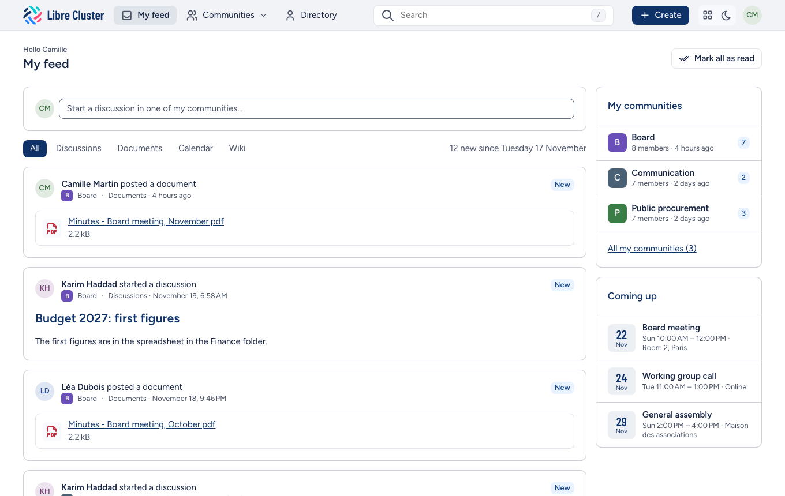
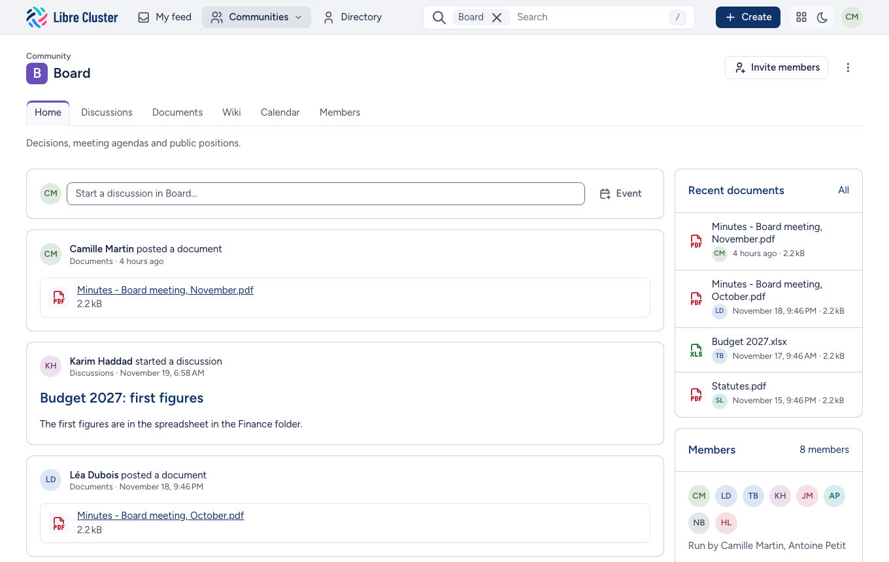

# Work together, in one place

**Abilian SBE** gives every team, project or working group of your organisation a **community**: a shared space with its discussions, its documents, its wiki and its calendar. Members see what is new in one feed, find anything with one search, and invite the people they work with.

It runs on your own server, in your language, and it is free software.

[Take the tour](guide/index.md){ .md-button .md-button--primary }
[Install it](install/index.md){ .md-button }

## Everything a group needs

-   :lucide-messages-square: **Discussions**

    ---

    Start a thread, reply, attach files. Each member sees what they have not read yet, and can follow by e-mail.

    [Discussions](guide/discussions.md)

-   :lucide-folder: **Documents**

    ---

    Keep documents in folders, with previews, versions, comments and permissions per folder. Upload many at once, and find them by their content.

    [Documents](guide/documents.md)

-   :lucide-book-open: **Wiki**

    ---

    Write pages in Markdown, linked by their titles, with a live preview, their history and their files.

    [Wiki](guide/wiki.md)

-   :lucide-calendar: **Calendar**

    ---

    Plan the community's events, a month at a glance, with files and a discussion for each, and add any of them to your own calendar.

    [Calendar](guide/calendar.md)

## Built for the way groups work

**One feed for everything new.** *My feed* gathers what happened in every community you belong to, newest first, and marks what came since you last looked. A daily e-mail sums it up for those who prefer their inbox.

**Communities that run themselves.** Each community has managers, who invite members, choose its tools and decide whether others may find and join it. Site administrators are needed only for the site itself.

**Find anything.** The search bar suggests discussions, documents, pages and people as you type, and searches inside documents too.

**A directory of people.** Who is who, what they do and where, and the communities you share with them.

## Who uses it

Abilian SBE has run in production since 2013, for clusters of companies, professional networks and associations, which use it as their extranet. Organisations that want their collaboration on their own infrastructure, under their own rules, and without per-user fees, use it in place of a hosted service.

## Free and open source

Abilian SBE is free software under the [LGPL v3](https://www.gnu.org/licenses/lgpl-3.0.html), developed by [Abilian](https://abilian.com/). You can run it, study it, change it and share it. Its source code is on [GitHub](https://github.com/abilian/abilian-sbe-monorepo).

- **Use it:** the [user guide](guide/index.md) walks through every tool.
- **Run it:** [install it](install/index.md) on a server, or on [Hop3](install/hop3.md) in a few commands.
- **Improve it:** the [developer guide](develop/index.md) explains how to build it and contribute.
